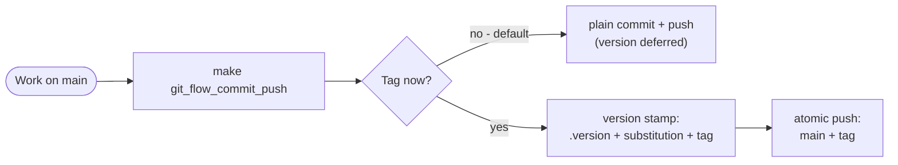
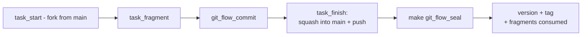
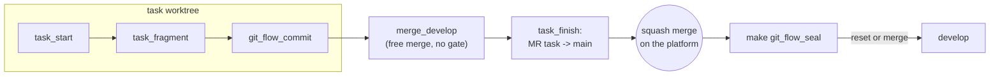
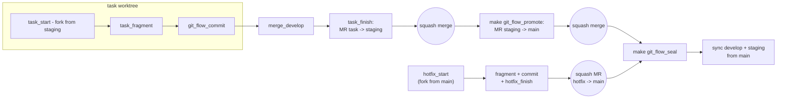
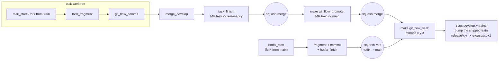
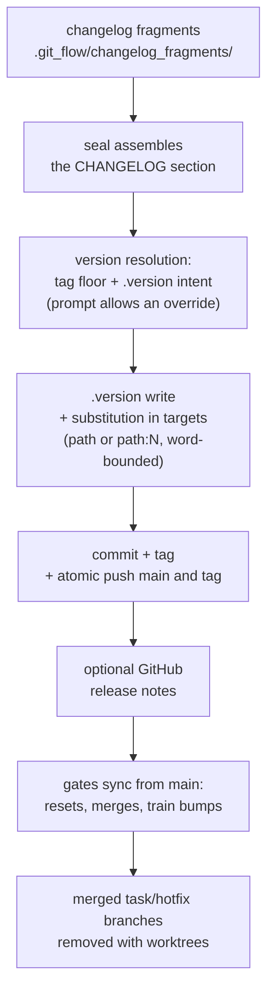

<!-- markdownlint-disable MD041 -->

[](https://rosinfo.tech)

# Rosinfotech Makefile

## Quick start

### Cloning

Clone the project and run following commands inside directory context:

### Setup

Makes available work with SSH files/directories transferring and other:

```bash
make setup
```

### Vendoring (project independence)

Makes a project independent from this repository - the only installation
path (the global-link workflow is gone):

```bash
make vendor /path/to/project     # from a clone of this repository
```

What it does:

- copies the framework into `.makefile/vendor/rosinfotech/` (fully managed
  directory, replaced wholesale on every run; a README manifest inside
  records the source commit SHA and update instructions);
- prepends standalone definitions to the project Makefile on the first run
  (marker-guarded; the original is backed up as `Makefile.bak.<timestamp>`;
  repeated runs only refresh the vendor directory);
- when the target has no Makefile, scaffolds a minimal project
  (`.version`, `CHANGELOG.md`, `README.md`, `.editorconfig`) - this
  scaffolds the project files when the target has no Makefile;
- validates the result with the system make and rolls back on failure.

Project scripts in `.makefile/` are never touched and take precedence over
the vendored ones (`resolve_script` chain: `.makefile/` ->
`.makefile/vendor/rosinfotech/`). After vendoring the plain system `make`
runs the project everywhere - no clone of this repository is required on
the machines using the project. Update the framework with `git pull` in a
clone of this repository followed by `make vendor /path/to/project`.

## Predefined make commands

### `make git_flow_commit_push`

Performs a git commit, push and push --tags with the specified commit message and version (works without a declared flow; with a flow declared the tag is gated):

```bash
make git_flow_commit_push "your commit message"
```

### `make echo`

Greets the user, shows the current version and lists available commands marking the ones whose scripts come from the vendored framework (`.makefile/vendor/rosinfotech/`):

```bash
make echo
```

### `make version_show`

Prints the current project version. Runs the `.makefile/version_show.sh` script.

```bash
make version_show
```

### `make version_update`

Synchronizes project version values. Runs the `.makefile/version_update.sh` script. The script reads the new version value from the 2nd line of the `./.version` file. The `.version` file also contains the current version (line 1) and relative file paths where the current version should be changed (lines 3+; a `path:N` entry pins the substitution to line N).

```bash
make version_update
```

## The Git Flow family

The `git_flow_*` commands implement the five variants of the Git Flow
Standard. Declare the variant once - `make git_flow_init <1..5>` writes the
`.git_flow/.git-flow-*` marker - and the rest of the family adapts: fork
bases, merge targets, guards and the versioning path.

| # | Name | Fork base | Path to main |
|---|------|-----------|--------------|
| 1 | Direct to Main (Trunk-Based) | main | direct commit |
| 2 | Free Merge to Main (GitHub Flow) | main | task_finish squashes into main |
| 3 | Reviewed Merge to Main (Git Flow Lite) | main | task -> develop, MR -> main |
| 4 | Reviewed Merge to Staging (GitLab Flow Lite) | staging | task -> develop, MR -> staging, promote -> main |
| 5 | Reviewed Merge to Release to Main (Git Flow) | release/x.y | task -> develop, MR -> train, promote -> main; entering main stamps x.y.0 |

Every task carries a changelog fragment
(`make git_flow_task_fragment "<Type>: <one English line>"`) - the seal
consumes the fragments and assembles the CHANGELOG section from them.

### Variant 1 - Direct to Main (Trunk-Based)

The commit is the seal: work lands on main directly, the version stamp is
part of the push.



### Variant 2 - Free Merge to Main (GitHub Flow)

A task branch lives in its own worktree; the finish squashes it into main
as one commit.



### Variant 3 - Reviewed Merge to Main (Git Flow Lite)

Tasks integrate into develop freely; the review gate is the merge request
into main.



### Variant 4 - Reviewed Merge to Staging (GitLab Flow Lite)

The staging queue collects reviewed tasks; the promotion merge request
carries them into main. A hotfix bypasses the queue and merges into main
directly.



### Variant 5 - Reviewed Merge to Release to Main (Git Flow)

Tasks ride the release train `release/x.y`; entering main stamps the minor
version `x.y.0` and the seal bumps the shipped train forward for the next
release.



### The seal - the sole versioning act



### Branch hygiene

`make git_flow_clear` scans local and remote branches and offers to remove
(prompt defaults to NO): fully delivered task/hotfix branches with their
worktrees and remote copies, remote-only leftovers, abandoned branches
(main was stamped after their fork), and flow branches unused by the
declared variant. Dirty worktrees, unmerged content and checked-out
branches are never offered.

### Environment overrides

| Variable | Effect |
|----------|--------|
| `FLOW_RELEASE=1\|0` | forces/defers the seal tag gate (non-TTY defers) |
| `FLOW_YES=1` | accepts the confirm-style prompts (agents, pipelines) |
| `FLOW_CLEAR=1` | forces `git_flow_clear` removal |

## Additional .makefile

- `.makefile/lib_ssh_client.sh` - the shared SSH transport: `sshClient` (init/exec/execf/scp/rsync/download/cleanup) plus the file/directory transfer helpers (`sshFileUpload`, `sshDirectoryUpload`, `sshDirectoryDownload`, `sshDirectoryDownloadAsArchive`). Auth: password via sshpass or an ssh key (the key takes precedence). Pure transport - no server registry and no logging; consumers layer their own on top (see the infra repository for the server-registry pattern). The `.makefile/.rsync-exclude` file next to it feeds `rsync --exclude-from` for the directory uploads;

- `.makefile/lib_secrets.sh` - generic secrets access: resolves the secrets file (`SECRETS_FILE` env override -> `~/.secrets.json`), checks jq and provides `getSecret <jq-path>`, `secretFile`, `requireSecrets`. The schema inside the file is owned by the consumer.

- `.makefile/setup.sh` - installs the system prerequisites (sshpass, rsync);

- You should create a `$HOME/.secrets.json` file to store and manage secrets (schema is owned by the consumer; `SECRETS_FILE` env var overrides the path):

  ```json
  {
      "example": {
          "ssh": {
              "host": "host",
              "port": "port",
              "username": "username",
              "password": "password",
              "ssh": "~/.ssh/id_ed25519"
          }
      }
  }
  ```

  The `ssh` field is optional: it points to a local private key — when set and the file exists, key authentication is used instead of the password (accepted as an optional `sshClient init` argument as well).

## AI Skills

Agent skills in the cross-agent `SKILL.md` format (any agent that supports the standard can use them - Kilo, Claude Code and others; typically referenced by their GitHub URLs from an `AGENTS.md` instructions file):

- `ai-skills/skill-makefile-git-flow-ready/` - formulate the git_flow action plan that promotes the made changes to a fully formed commit and a production version (github.com/rosinfotech/makefile/tree/main/ai-skills);

- `ai-skills/skill-makefile-initialize-repository/` - initialize a git repository for the makefile workflow;

- `ai-skills/skill-makefile-version-update/` - update the project version (.version, CHANGELOG.md);
